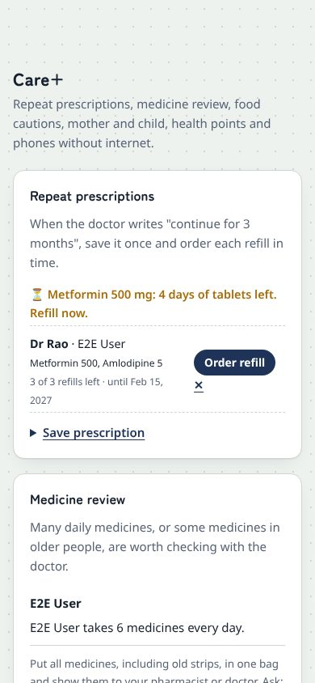
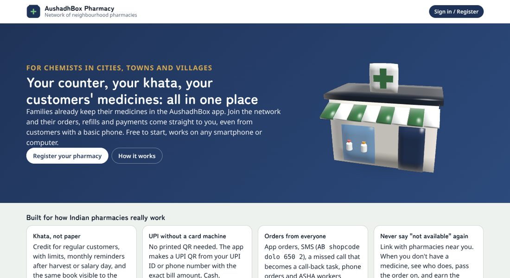
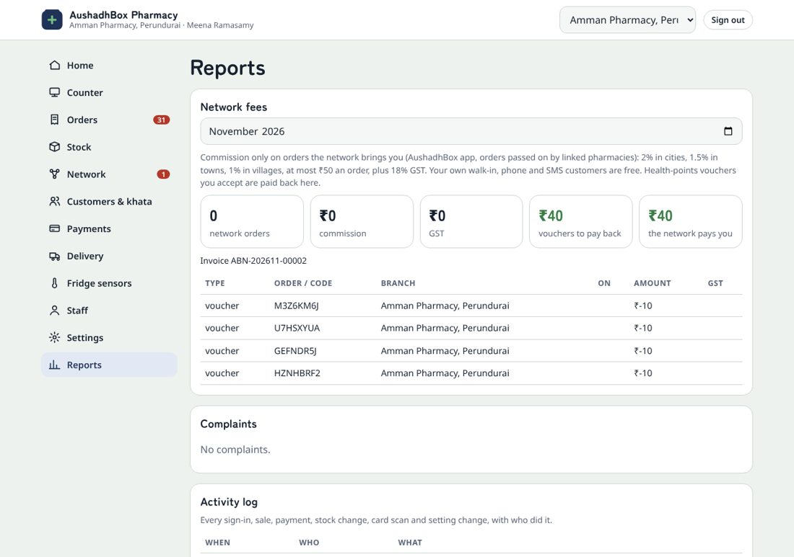
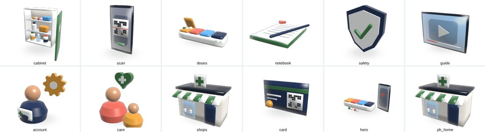
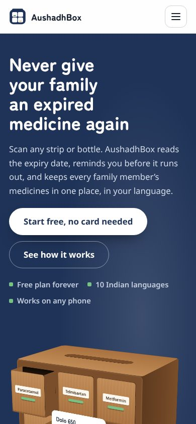
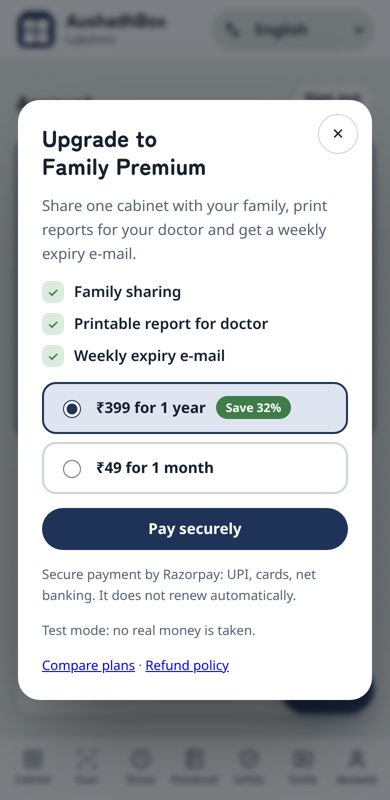
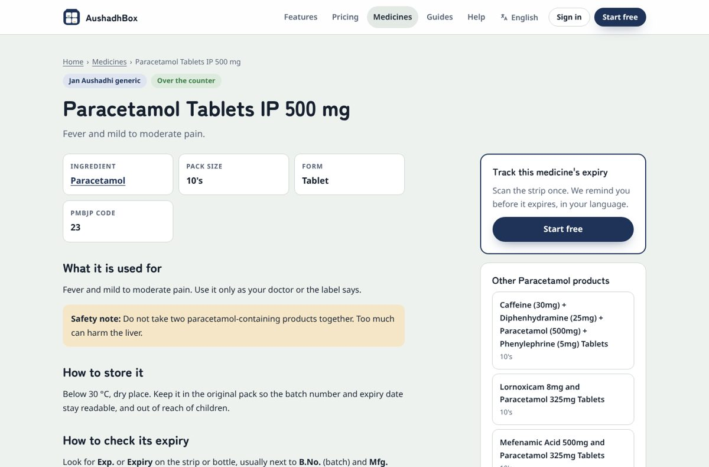

# AushadhBox — family medicine cabinet and pharmacy network for India

**AushadhBox helps Indian families keep track of their medicines and links them with neighbourhood pharmacies, in cities, towns and villages.**
It is two linked products: a family web app (installable on phones, 10 Indian languages) and a separate pharmacy network for chemists.
Built end to end by **Jayakiruthika G** · [LinkedIn](https://www.linkedin.com/in/jayakiruthikag/) · [Figma designs](https://www.figma.com/design/PK9KGNnylGHJcH9ee9r4Qv)

| Family app (phone) | Pharmacy network | 3D models on every screen |
|---|---|---|
|  |   |  |

## Highlights

- **Scan to add:** reads medicine strips, prescriptions in Indian shorthand (1-0-1, BD, HS) and pharmacy bills into a ready list.
- **Doses that actually get taken:** reminders, a smart ESP32 pillbox, missed-dose alerts to the family, SMS and "missed call = taken" for basic phones.
- **Care+:** repeat prescriptions, medicine review for older people, mother-and-child tracker (MCP card), health points turned into pharmacy vouchers.
- **Pharmacy network:** counter, khata (credit book), UPI QR from the shop's UPI ID, linked pharmacies that pass on a missing medicine, delivery when the trip is worth it, monthly fee statement.
- **Data and IoT:** nightly Python demand forecasts, a Java agent that syncs stock from any billing software, an ESP32 fridge thermometer for insulin.
- **Privacy and security:** family-controlled consent per pharmacy, signed links between the two products, encrypted customer data, DPDP Act 2023 rights (see [SECURITY.md](SECURITY.md)).
- **Quality:** 12 automated test suites (948 checks) run on every push with GitHub Actions.

## Tech stack

| Layer | Used |
|---|---|
| Backend | PHP 8.1+ (no framework), MySQL 8 / MariaDB 10.6+, PDO with prepared statements |
| Frontend | HTML, CSS, vanilla JavaScript, Progressive Web App, own WebGL 3D viewer, 10 languages |
| Data | Python 3 (standard library only): forecasting, reorder, expiry, delivery routing |
| Integrations | Java 17 sync agent, HMAC-signed APIs, Razorpay, UPI deep links, SMS / missed-call webhooks, FHIR export |
| Hardware | ESP32 (Arduino and MicroPython) pillbox and fridge sensor |
| Design and tools | Figma, Blender (Python bpy), Playwright, GitHub Actions |

## Run it locally

```sh
# Family app (needs PHP 8.1+ and MySQL/MariaDB)
cp public_html/core/config.example.php public_html/core/config.php   # fill in the database details
cd public_html && php -S 127.0.0.1:8080 index.php                     # then open http://127.0.0.1:8080/install.php
# Pharmacy network (its own database)
cp pharmacy-platform/core/config.example.php pharmacy-platform/core/config.php
php pharmacy-platform/tools/install.php you@example.in "Your Name" 'a-strong-password' && cd pharmacy-platform/public && php -S 127.0.0.1:8090 index.php
```

**Stack in one line:** PHP 8.1+ (no framework) · MySQL 8 / MariaDB 10.6+ · HTML, CSS, JavaScript (no build step) ·
Progressive Web App · Razorpay · runs on any ₹150/month shared host (Hostinger, cPanel).

| Website (10 languages) | App on a phone | Admin dashboard |
|---|---|---|
|  |  |  |
|  |  |  |

## What's in the box

| Part | What it does |
|---|---|
| **Website** (`/`) | Home page and pricing in **10 Indian languages** (English, हिन्दी, বাংলা, मराठी, తెలుగు, தமிழ், ગુજરાતી, ಕನ್ನಡ, മലയാളം, ਪੰਜਾਬੀ). About, Help centre, Contact form, Privacy, Terms, Refund and Cookie policies. |
| **SEO pages** | 2,111 Jan Aushadhi medicine pages (737 with full guides are indexed), 74 ingredient guides, 5 articles. Sitemap with 846 URLs, hreflang, canonical tags, Open Graph images, structured data (Organization, WebSite, SoftwareApplication, Product, FAQ, Drug, Article, Breadcrumb). |
| **App** (`/app`) | Scan medicine strips, bottles and QR codes; expiry status; family members; dose ticks and phone reminders; medicine notebook; voice assistant in 10 languages; welcome tour. |
| **Money** | Free plan (4 people, 30 medicines) and **Family Premium** (₹49/month or ₹399/year, configurable): family sharing for up to 6 accounts, unlimited medicines, printable doctor report, weekly expiry e-mail. Razorpay checkout + webhook. No auto-renewal; reminder e-mail before it ends. |
| **Smart adding** | One scan button tells a strip, a prescription and a pharmacy bill apart. Prescriptions in Indian shorthand (1-0-1, BD, TDS, HS, SOS, "x 5 days", after food; Hindi and Tamil words) and pharmacy bills (batch, expiry, quantity) become a ready-to-save list. Usual schedules for 74 ingredients and tablet counts from the pack size are filled in. Add by typing or speaking one sentence. Share a photo from WhatsApp into the app. |
| **Taken, skipped or missed** | Skip a dose with a reason (side effects → family told; ran out → shopping list; doctor stopped → reminders end). "Did you take it?" goes to the person first, the family only if there is no answer. Weekly report per person in the app, as a Sunday notification and in the doctor report. |
| **Smart pillbox (IoT)** | ESP32 pill organiser with a reed switch per lid: opening the right lid at dose time ticks the dose, a second opening warns the family, lights and beeps at dose time, works offline. Firmware, wiring, parts list (about ₹900), build guide and a simulator in `hardware/`. |
| **Automations** | "✓ Taken" on the reminder notification; "All taken" per time of day; reminder times that move to the family's real routine; shopping list with generics shared on WhatsApp; tablet count goes down by itself with each ticked dose; refill alerts before medicine runs out; missed-dose alerts to the whole family; reminders stop when a course ends; monthly clean-up list; a dose calendar for Google Calendar and iPhone. Each can be switched on or off. |
| **Autopilot (admin)** | Ask your data in plain words (with charts); anomaly detection on every daily number (robust z-score); growth tips; daily digest by e-mail and push; support autopilot (ticket numbers, category, priority, mood, reply targets, automatic acknowledgement, drafted replies, one-click send); system health with self-healing (migrations, cache, old logs, unlinked medicines, stuck Razorpay payments); family health scores and segments (likely to upgrade, at risk, not started, gone quiet) with automatic helpful reminders; IndexNow; admin audit log. Optional AI (Claude or any OpenAI-compatible API) with rule-based fallbacks everywhere. |
| **Safety (families)** | Automatic checks every time a medicine is added: the same medicine in two brands, two of the same kind, well-known risky pairs, medicines to take hours apart, and allergies. 200+ Indian brand names recognised (Dolo, Crocin, Telma, Augmentin…). Optional AI helper (with consent) answers questions about the family's own medicines in their language. Habit patterns in the weekly report (weekend misses, late doses). |
| **Ideas from Japan** | From Japanese medication-notebook apps (お薬手帳) and pharmacy follow-up (see docs/IDEAS-FROM-JAPAN.md): health diary with safe-range checks and charts; follow-up check-ins on day 3 and day 10 of a new medicine; doctor visits with reminders and a visit sheet (tablets left, doses, side effects, readings, questions); "My pharmacy" on WhatsApp; offline emergency card with QR code and home-screen shortcut; watch-over alerts for parents living alone; printable weekly medicine calendar. |
| **Family extras (like EPARK)** | Children's vaccination schedule (India's UIP) made from the date of birth, with reminders; medical expenses (scanned pharmacy bills add themselves) with a CSV for the tax year; 24-hour read-only link for the doctor; Bluetooth BP / sugar / thermometer / scale / oximeter readings that save themselves; lab results (HbA1c, cholesterol, haemoglobin); dose streaks. |
| **AushadhBox card** | Like Japan's harmo: each person gets a QR card, or a **one-time 6-digit code** for a pharmacy that can't scan. Approved pharmacies add the medicines they give straight into the family's app; a safety check runs before handing over. **Off by default**: the family switches on "may add" / "may see" per person, sees every access, and can block a pharmacy or replace the card. |
| **Care+** | Repeat prescriptions ("continue for 3 months": order each refill in time, the pharmacy sees the doctor and the refill count); medicine review for older people and many-medicine households (Beers-style list); food and drink cautions per medicine; mother and child (MCP-card check-ups, free PMSMA day on the 9th, IFA tablets, danger signs, JSSK / PMMVY reminders, child growth); **health points** for readings, all doses, check-ups and vaccines, turned into vouchers for non-prescription items at network pharmacies. |
| **Villages and basic phones** | Low-data mode (no video or 3D), district / village and ASHA-worker settings; SMS dose reminders (DLT templates) and a **missed call = dose taken** line for family members with a ₹1,200 phone; door / motion / power sensors as a sign of life for parents living alone; UPI 123PAY help (IVR or missed-call UPI from any phone). |
| **AushadhBox Pharmacy Network** (`pharmacy-platform/`, its own server and database) | A separate product for chemists, linked to the family app by signed (HMAC) calls: counter with card / QR scan, orders from the app, SMS, missed calls and ASHA workers; **linked pharmacies** (a missing medicine is found in a nearby shop and passed on; delivery when the distance is short, or when the trip is worth it: margin, essential medicine, village pickup point); stock with batches, FEFO and expiry; khata (credit book) with reminders; UPI QR from the shop's UPI ID (no printed QR needed) with claim-and-confirm; delivery by own riders or couriers with OTP hand-over; staff roles; Schedule H/H1/X registers; fridge sensors; dose-pouch labels (一包化); monthly **network fee statement** (commission only on network orders, lower in towns and villages, nothing for Jan Aushadhi Kendras, minus health-point vouchers) and admin settlement; nightly Python forecasts (reorder, expiry, transfers, demand spikes, delivery rounds); a Java agent that uploads stock from any billing software; an ESP32 fridge thermometer. See `pharmacy-platform/README.md`. |
| **3D on every screen** | 21 models (pillbox, cabinet, pharmacy, scooter, fridge…) described once in `tools/models3d/spec.py`, built for the web by plain Python and in Blender by `blender_build.py`, shown by a 9 KB WebGL viewer of our own (drag to turn; still for reduced motion; off in low-data mode). |
| **UI/UX design** | Figma file with colour tokens, text styles, components (Button, Pill, KPI, tab bar), 4 phone screens (doses, Care+, pharmacy order with UPI, basic-phone SMS flow) and 3 portal screens (dashboard, network fees, linked-pharmacy order with pouch labels): https://www.figma.com/design/PK9KGNnylGHJcH9ee9r4Qv |
| **Smartwatch (any brand)** | Reminders with the Taken button on any watch paired to the phone; a watch page (`/watch`) with one big button for round screens; a secret tap-to-tick link for Siri Shortcuts (Apple Watch), Google Assistant / Bixby routines, NFC stickers or a printed QR on the medicine box; import readings from Apple Health, Samsung Health, Google Fit and Fitbit exports (read in the browser). Setup notes for Wear OS, Galaxy, Apple, Fitbit, Garmin, Amazfit, Noise, boAt, Fire-Boltt, Mi Band. |
| **Barcodes** | A pack scanned with its barcode (EAN / GS1) is remembered, so the next family scanning the same pack gets the name filled in. |
| **Cookie consent** | Accept / Reject / Choose banner in 10 languages. Analytics run **only after Accept**. Choices are logged as proof. Withdrawing deletes past statistics. |
| **Admin** (`/admin.html`) | Revenue, Premium families, conversion, sign-ups, visitors, top pages, traffic sources, button clicks, devices, payments, contact messages, medicine-list import. |
| **Privacy & security** | DPDP Act 2023 / Rules 2025: consent at sign-up, download my data, delete account, grievance officer, retention clean-up. bcrypt, CSRF, rate limits, ownership checks, CSP, HTTPS, private `core/` folder. |

## Folder structure
```
public_html/            ← upload the contents of this folder to your host
  index.php             website router (all public pages)
  app.html app.js styles.css i18n*.js      the web app (served at /app)
  site.css site.js consent.js consent-i18n.js   website styles, cookie banner
  api.php               JSON API for the app
  device.php            API for the smart pillbox (token, no cookies)
  core/autopilot.php support.php health.php ai.php safety.php assistant.php   autopilot, support sorting, health, AI, safety checks
  core/care.php         health diary, follow-up check-ins, visit sheet, watch-over
  core/household.php    vaccinations, medical expenses, doctor links, streaks
  core/pharmacy.php     AushadhBox card: consent, pharmacy view, safety pre-check, dispensing, refills
  core/watch.php        smartwatch page data, tap-to-tick link, watch / health-app imports
  core/careplus.php     repeat prescriptions, medicine review, food cautions, mother and child, points, SMS / missed calls, FHIR export
  careplus.js network.js   Care+ screen; pharmacy network (find, order, pay, khata) in the family app
  partner_api.php telephony.php   signed calls from the pharmacy platform; missed-call webhook
  scene3d.js assets/3d/  3D viewer and models
  watch.html watch.js watch.css   watch page (/watch)
  ble-health.js health-import.js  Bluetooth meters, Apple Health / Samsung / Google Fit / Fitbit import
  webhook.php           Razorpay webhook
  cron.php install.php  scheduled jobs, one-time installer
  admin.html admin.js   admin dashboard
  img/ icons/ assets/ lib/   images, app icons, audio/video, scanner libraries
  core/                 PRIVATE (blocked by .htaccess)
    config.example.php  → copy to config.php and fill in
    site.php plans.php catalog.php services.php bootstrap.php i18n_site.php
    pages/ views/       website pages and templates
    content/guides.php  articles (add more here)
    database/           schema, ingredient guides, Jan Aushadhi list
pharmacy-platform/      AushadhBox Pharmacy Network: its own public/ (portal, admin, partner API), core/, analytics/ (Python),
                        sync-agent/ (Java), iot/coldchain/ (ESP32 fridge sensor), tests/
hardware/               smart pillbox: README (build guide), wiring.svg, firmware/ (ESP32 Arduino), simulator/ (Python)
docs/                   IDEAS-FROM-JAPAN, DEPLOY, HANDOVER, SRS, DESIGN, design-system.html, TEST-REPORT, USER-MANUAL, SEO-GROWTH
tests/                  seo_check.php, api_test.sh, e2e.js, rx_parse_test.js, ble_parse_test.js, health_import_test.js, autopilot_test.php
tools/                  import_list.php, make_vapid_keys.php, build_assets.php, media generators, models3d/ (3D models: spec, Python and Blender builders)
```

## Preview and GitHub automation
- `tools/preview/build_preview.py` builds a static demo of the site and app (the app runs on `tools/preview/demo-api.js`, an in-browser stand-in for the server) for showing the project without hosting.
- `.github/workflows/test.yml` runs every test on each push; `deploy.yml` uploads to Hostinger after tests pass (switched on with repository secrets, see docs/DEPLOY.md); `health.yml` checks the live site every morning.

## Run it on your laptop
1. Install PHP 8.1+ and MySQL/MariaDB (XAMPP on Windows is fine). Create a database `aushadhbox` (utf8mb4).
2. Copy `public_html/core/config.example.php` to `config.php`; fill in the database and a `cron_key`. Set `'payments_demo' => true` to try Premium without Razorpay.
3. `cd public_html && php -S localhost:8000 index.php`
4. Open `http://localhost:8000/install.php`, then `http://localhost:8000/`.

## Go live
Read **docs/DEPLOY.md** (Hostinger step by step, Razorpay, Google Search Console), then **docs/HANDOVER.md** for the launch checklist.

## Data sources
- PMBJP product list, "List of 2110 generic medicines under PMBJP till 31.12.2025", Government of India (PIB).
- CDSCO guidance on disposal of expired/unused drugs (2025); CDSCO FAQs on QR codes (2023); Drugs Rules 1945.
- Ingredient guides are general information written for this project, not medical advice.

> AushadhBox helps families organise medicines. It does not replace a doctor or pharmacist.

## License

Source-available under the [PolyForm Noncommercial License 1.0.0](LICENSE.md): free to read, learn from and use for non-commercial purposes. Commercial use needs written permission from the author.
