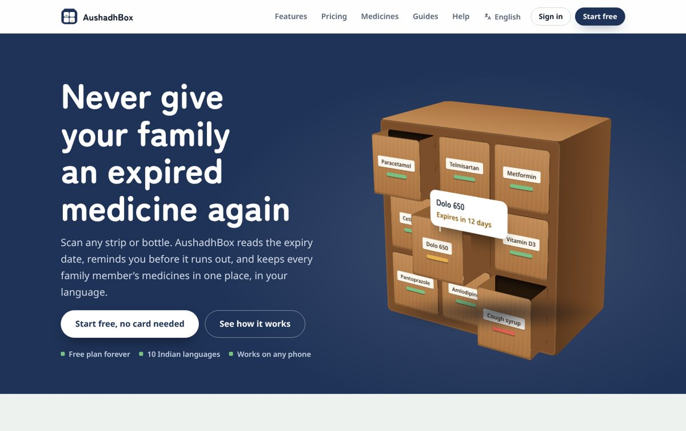
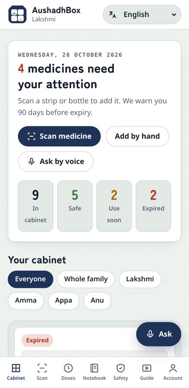
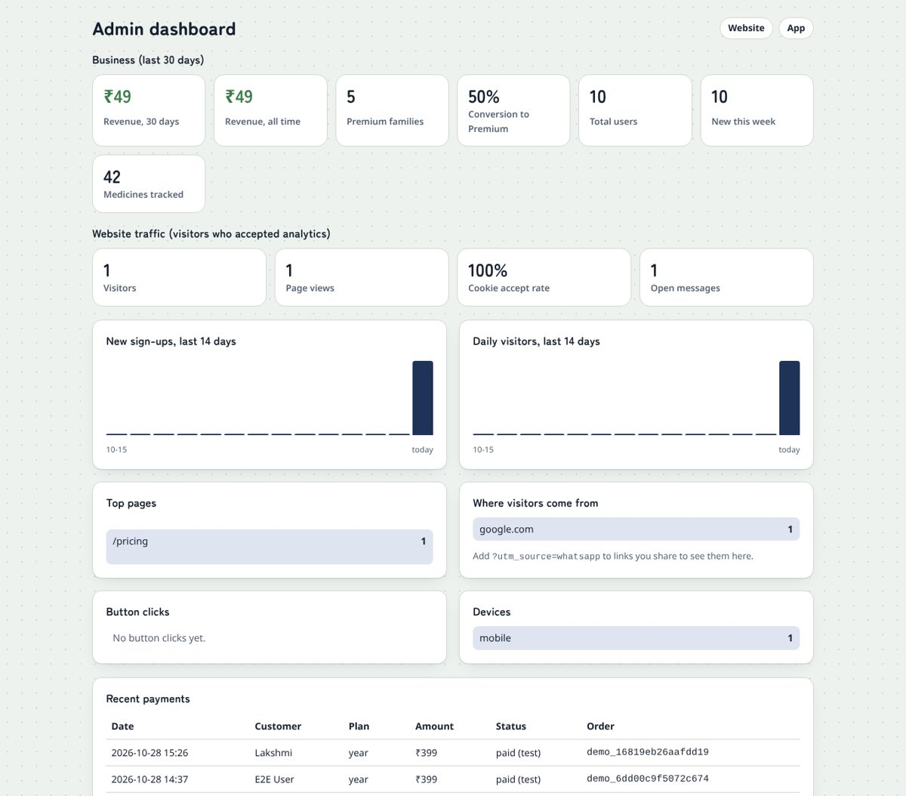

# AushadhBox v3 — family medicine cabinet for India

A complete, deployable web product: a public marketing website built for Google search, a multilingual
web app (installable on phones), a Premium plan with Razorpay payments, family sharing, a cookie-consent
system that follows the DPDP Act, and an admin dashboard with business numbers.

**Stack:** PHP 8.1+ (no framework) · MySQL 8 / MariaDB 10.6+ · HTML, CSS, JavaScript (no build step) ·
Progressive Web App · Razorpay · runs on any ₹150/month shared host (Hostinger, cPanel).

| Website (10 languages) | App on a phone | Admin dashboard |
|---|---|---|
|  |  |  |
|  |  |  |

## What's in the box

| Part | What it does |
|---|---|
| **Website** (`/`) | Home page and pricing in **10 Indian languages** (English, हिन्दी, বাংলা, मराठी, తెలుగు, தமிழ், ગુજરાતી, ಕನ್ನಡ, മലയാളം, ਪੰਜਾਬੀ). About, Help centre, Contact form, Privacy, Terms, Refund and Cookie policies. |
| **SEO pages** | 2,111 Jan Aushadhi medicine pages (737 with full guides are indexed), 74 ingredient guides, 5 articles. Sitemap with 846 URLs, hreflang, canonical tags, Open Graph images, structured data (Organization, WebSite, SoftwareApplication, Product, FAQ, Drug, Article, Breadcrumb). |
| **App** (`/app`) | Scan medicine strips, bottles and QR codes; expiry status; family members; dose ticks and phone reminders; medicine notebook; voice assistant in 10 languages; welcome tour. |
| **Money** | Free plan (4 people, 30 medicines) and **Family Premium** (₹49/month or ₹399/year, configurable): family sharing for up to 6 accounts, unlimited medicines, printable doctor report, weekly expiry e-mail. Razorpay checkout + webhook. No auto-renewal; reminder e-mail before it ends. |
| **Cookie consent** | Accept / Reject / Choose banner in 10 languages. Analytics run **only after Accept**. Choices are logged as proof. Withdrawing deletes past statistics. |
| **Admin** (`/admin.html`) | Revenue, Premium families, conversion, sign-ups, visitors, top pages, traffic sources, button clicks, devices, payments, contact messages, medicine-list import. |
| **Privacy & security** | DPDP Act 2023 / Rules 2025: consent at sign-up, download my data, delete account, grievance officer, retention clean-up. bcrypt, CSRF, rate limits, ownership checks, CSP, HTTPS, private `core/` folder. |

## Folder structure
```
public_html/            ← upload the contents of this folder to your host
  index.php             website router (all public pages)
  app.html app.js styles.css i18n*.js      the web app (served at /app)
  site.css site.js consent.js consent-i18n.js   website styles, cookie banner
  api.php               JSON API for the app
  webhook.php           Razorpay webhook
  cron.php install.php  scheduled jobs, one-time installer
  admin.html admin.js   admin dashboard
  img/ icons/ assets/ lib/   images, app icons, audio/video, scanner libraries
  core/                 PRIVATE (blocked by .htaccess)
    config.example.php  → copy to config.php and fill in
    site.php plans.php catalog.php services.php bootstrap.php i18n_site.php
    pages/ views/       website pages and templates
    content/guides.php  articles (add more here)
    database/           schema, ingredient guides, Jan Aushadhi list
docs/                   DEPLOY, HANDOVER, SRS, DESIGN, design-system.html, TEST-REPORT, USER-MANUAL, SEO-GROWTH
tests/                  seo_check.php, api_test.sh
tools/                  import_list.php, make_vapid_keys.php, build_assets.php, media generators
```

## Run it on your laptop
1. Install PHP 8.1+ and MySQL/MariaDB (XAMPP on Windows is fine). Create a database `aushadhbox` (utf8mb4).
2. Copy `public_html/core/config.example.php` to `config.php`; fill in the database and a `cron_key`. Set `'payments_demo' => true` to try Premium without Razorpay.
3. `cd public_html && php -S localhost:8000 index.php`
4. Open `http://localhost:8000/install.php`, then `http://localhost:8000/`.

## Go live
Read **docs/DEPLOY.md** (Hostinger step by step, Razorpay, Google Search Console), then **docs/HANDOVER.md** for the launch checklist.

## Data sources
- PMBJP product list, "List of 2110 generic medicines under PMBJP till 31.12.2025", Government of India (PIB).
- CDSCO guidance on disposal of expired/unused drugs (2025); CDSCO FAQs on QR codes (2023); Drugs Rules 1945.
- Ingredient guides are general information written for this project, not medical advice.

> AushadhBox helps families organise medicines. It does not replace a doctor or pharmacist.
