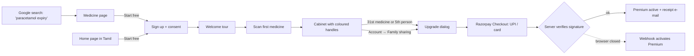
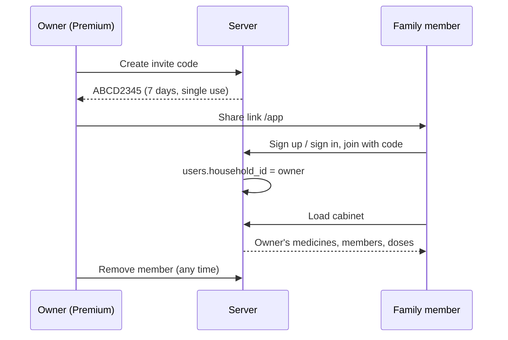
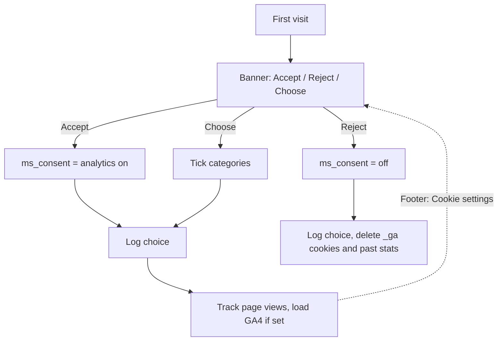
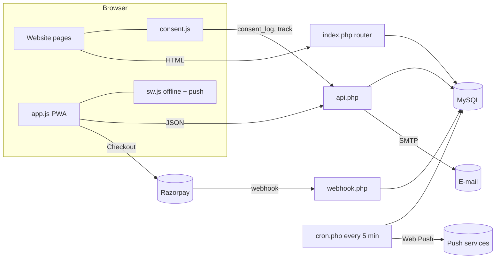
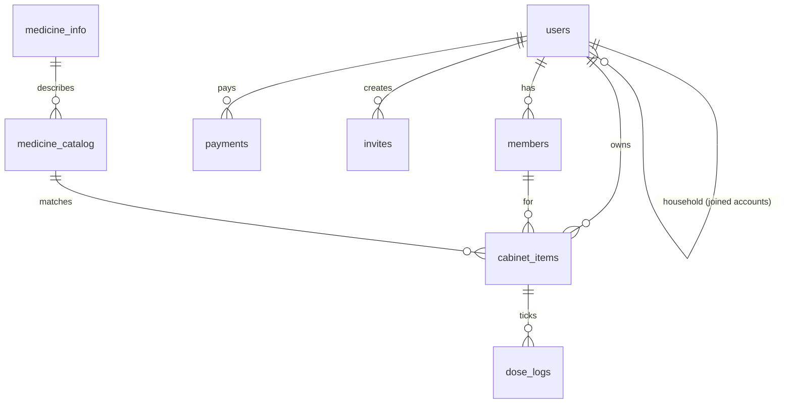

# Design document — MediShelf-Sync v3

## 1. Concept
The visual idea is the Japanese **kusuri-dansu**, the wooden apothecary chest with many small drawers. Every medicine is a drawer; the **handle colour** is its status: green safe, amber use soon, red expired. The same three colours appear on the website, in the app, in e-mails and on the printed report, so families learn the signal once.

Indigo (*ai-iro*), a traditional Japanese dye colour, is the brand colour. It reads as trustworthy and calm, and stays readable for people with colour-vision differences because status is never shown by colour alone (labels "Safe / Use soon / Expired" are always present).

The visual system is documented interactively in **design-system.html** (open it in a browser).

## 2. Design tokens
| Token | Light | Dark | Use |
|---|---|---|---|
| `--paper` | #EEF2EF | #0F141B | Page background |
| `--surface` | #FFFFFF | #171E28 | Cards, panels |
| `--ink` | #16202E | #E7ECF2 | Text |
| `--muted` | #566274 | #9AA6B6 | Secondary text |
| `--ai` | #1F3358 | #A9BDEA | Brand, primary buttons, links |
| `--ok` | #3E7D49 | #78C084 | Safe |
| `--warn` | #A86C08 | #E7B24E | Use soon |
| `--bad` | #B3382A | #F08070 | Expired, Rx |

Type: **Zen Maru Gothic** (rounded Japanese display face) for headings; **Noto Sans** plus the matching Noto script (Devanagari, Tamil, Telugu, Kannada, Malayalam, Bengali, Gujarati, Gurmukhi) for text, so every language looks consistent. Radius 16 px for cards, pill buttons, 8 px spacing grid. All text meets WCAG AA contrast in both themes.

## 3. Information architecture
```
/                     Home (10 languages: /hi/ /ta/ …)
/pricing              Plans (10 languages)
/medicines            Directory → /medicines/{slug}
/ingredients          Guides → /ingredients/{slug}
/guides               Articles → /guides/{slug}
/about /help /contact
/privacy /terms /refund-policy /cookie-policy
/app                  Web app (noindex): Cabinet · Scan · Doses · Notebook · Safety · Guide · Account
/report               Printable report (Premium, signed in)
/admin.html           Admin dashboard
```

## 4. Key user flows

### 4.1 Visitor to paying family


### 4.2 Family sharing


### 4.3 Cookie consent


## 5. Architecture

- **No framework, no build step.** Every file can be edited in File Manager and uploaded; this keeps hosting cheap and maintenance possible without a developer.
- `core/` holds all PHP logic and data and is blocked from the web. `site.php` routes public pages; views are plain PHP templates; `plans.php` holds plans, households and Razorpay; `catalog.php` matches labels to medicines.
- Households: a joined account stores `household_id = owner`. Every cabinet query uses `hid(user)`, so sharing needs no data copying, and leaving is one update.

## 6. Data model


## 7. UX decisions
| Decision | Why |
|---|---|
| Upgrade prompt appears exactly when a limit is reached, with the reason | People pay when they feel the need, not on a random banner |
| Yearly plan pre-selected with "Save 32%" | Yearly customers stay longer and reduce payment fees |
| No auto-renewal, 3-day reminder | Builds trust in a market wary of hidden subscriptions; avoids RBI e-mandate complexity |
| Reject button as visible as Accept | Required for valid consent; dark patterns are avoided |
| Medicine pages end with "Track this medicine's expiry" | Turns search visitors into sign-ups |
| Welcome tour of 4 cards, skippable, ends on Scan | Gets the first medicine in quickly, which predicts retention |
| Report is a web page with print CSS | Works on any phone; "Save as PDF" comes free from the browser |
| Text sizes ≥ 16 px, large tap targets, plain words | Many users are older family members |
