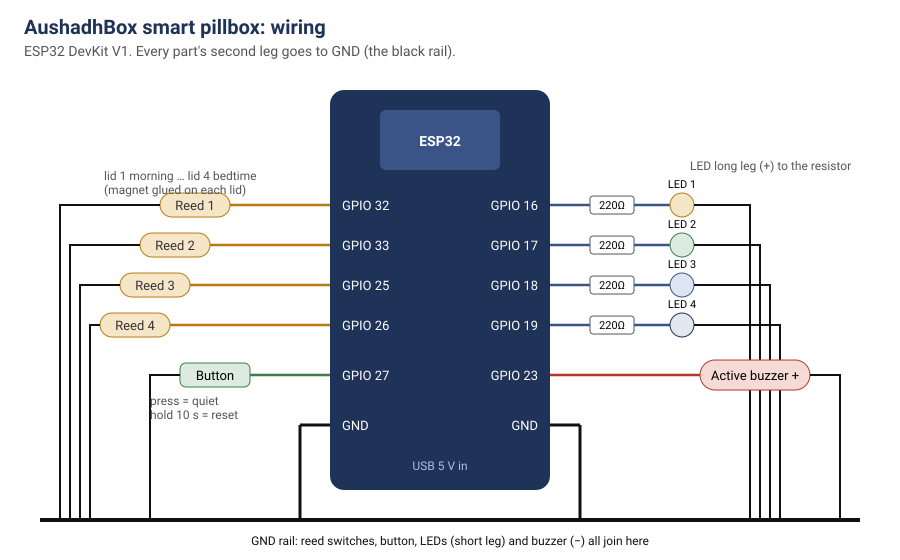

# AushadhBox smart pillbox (IoT)

A weekly pill organiser that tells AushadhBox when a lid is opened. Opening the right lid at dose time ticks the dose in the app by itself, so elderly parents don't have to use a phone at all.



## What it does

| Situation | What happens |
|---|---|
| Dose time arrives | That lid's LED blinks and the buzzer beeps (again after 10 and 20 minutes). |
| Lid opened from 1 hour before to 3 hours after the dose time | The doses in that time slot are ticked in the app as **"by pillbox"** and the tablet count goes down. The LED stops. |
| Same lid opened again more than 5 minutes later | The family gets **"lid opened again: check a second dose was not taken"**. |
| Lid opened at another time (filling the box on Sunday) | Recorded only, nothing ticked. |
| Lid not opened | The person gets **"Did you take your morning medicines?"** with Taken / Skip buttons. If there's still no answer, the family is told. |
| Wi-Fi down | The box keeps up to 64 openings with their times and sends them when it reconnects (up to 3 days later). |
| Box offline for a day, or battery ≤ 15 % | The family is told. |
| Sunday 6 pm | "Fill the pillbox for the week" reminder. |

**Limits.** An open lid is a strong hint, not proof that the tablet was swallowed. Anyone can untick a dose in the app if the guess was wrong. The weekly report shows how many doses were confirmed by the pillbox.

## How the prediction works

```
lid opened at time T  ─►  which time slot?
                          4-lid box: lid 1 = morning, 2 = afternoon, 3 = evening, 4 = bedtime
                          1-lid box: the dose time closest to T
                     ─►  is T inside [dose time − 60 min, dose time + 180 min]?
                          no  → "outside" (refilling): record only
                          yes → doses due in that slot for the box's person
                                 none due          → "nodose"
                                 not yet ticked    → tick them, source = box   → "taken"
                                 already ticked by the box > 5 min ago → "again" → family warned
                                 already ticked in the app → "already"
```

The code is in `public_html/core/pillbox.php`. The box's API is `public_html/device.php`.

## Parts (about ₹900)

| # | Part | Approx. price | Notes |
|---|---|---|---|
| 1 | ESP32 DevKit V1 (30-pin, ESP-WROOM-32) | ₹350 | Wi-Fi microcontroller |
| 4 | Reed switch (normally open, glass, 2 × 14 mm) | ₹60 | One under each lid |
| 4 | Neodymium magnet 6 × 2 mm | ₹40 | Glued on each lid, above its reed switch |
| 4 | 5 mm LED (any colours) | ₹10 | One per lid |
| 4 | 220 Ω resistor | ₹5 | For the LEDs |
| 1 | Active buzzer 3–5 V | ₹20 | Makes the beep. Use an NPN transistor (BC547) and 1 kΩ if it draws more than 20 mA. |
| 1 | Tactile push button 6 × 6 mm | ₹5 | Quiet / reset |
| 1 | Pill organiser with 4 lids per day, or a 4-compartment box | ₹150 | Plastic, at least 15 mm of space under the lids |
| 1 | Small perfboard, jumper wires, hot glue | ₹100 | |
| 1 | 5 V USB phone charger and micro-USB cable | (reuse one) | Keep the box plugged in |
| *opt.* | 18650 cell + holder + TP4056 charger module + 2 × 100 kΩ | ₹250 | To run without a cable. Set `HAS_BATTERY 1` in `config.h`. |

Tools: soldering iron, multimeter (useful for checking the reed switches), hot glue gun, small drill.

## Wiring

| ESP32 pin | Connect to | Other leg |
|---|---|---|
| GPIO 32 | Reed switch, lid 1 (morning) | GND |
| GPIO 33 | Reed switch, lid 2 (afternoon) | GND |
| GPIO 25 | Reed switch, lid 3 (evening) | GND |
| GPIO 26 | Reed switch, lid 4 (bedtime) | GND |
| GPIO 16 / 17 / 18 / 19 | 220 Ω → LED long leg (+), lids 1–4 | LED short leg → GND |
| GPIO 23 | Buzzer + | Buzzer − → GND |
| GPIO 27 | Push button | GND |
| GPIO 34 *(optional)* | Middle of 100 kΩ / 100 kΩ divider from battery + | Divider bottom → GND |
| 5V / VIN, GND | USB power (or TP4056 OUT+ / OUT−) | |

No external pull-up resistors are needed: the firmware uses the ESP32's internal pull-ups. A closed lid (magnet close) closes the reed switch and the pin reads LOW. An open lid reads HIGH.

For a box with **one lid**, wire only GPIO 32 and GPIO 16 and choose "1 lid" when adding it in the app.

## Build it

1. **Test the reed switches first.** Put the multimeter in continuity mode and bring a magnet near each switch. It should beep within about 1 cm. Glass reed switches crack easily, so bend their legs gently with pliers, never at the glass.
2. **Mark the positions.** Close each lid and mark where the lid's edge sits over the box wall. The magnet goes on the lid, and the reed switch goes inside the wall directly under it, so they are 2–5 mm apart when the lid is closed.
3. **Fix the switches.** Glue each reed switch inside the wall (or under the floor of the compartment, wrapped in tape, so tablets never touch it) and run its two wires down to the base.
4. **Fix the magnets.** Glue a magnet on each lid. Open and close the lid while measuring: the switch must close when the lid is shut and open when it lifts about 1 cm.
5. **LEDs.** Drill a 5 mm hole in front of each compartment and push an LED through so its glow is visible. Solder a 220 Ω resistor to each long leg.
6. **Electronics.** Mount the ESP32, buzzer and button on the perfboard in a compartment under the box, or in a small enclosure behind it. Solder as in the table. Join all the GND wires to one GND pin.
7. **Power.** Run the USB cable out of the back. Leave the ESP32's USB port reachable for updating the firmware.

## Load the software (firmware)

1. Install the **Arduino IDE** (2.x).
2. *File → Preferences → Additional boards manager URLs*: add
   `https://raw.githubusercontent.com/espressif/arduino-esp32/gh-pages/package_esp32_index.json`
3. *Tools → Board → Boards Manager*: install **esp32 by Espressif Systems**.
4. *Tools → Manage Libraries*: install **WiFiManager** (by tzapu) and **ArduinoJson** (by Benoit Blanchon, version 7).
5. Open `firmware/aushadhbox-pillbox/aushadhbox-pillbox.ino`. If needed, change `config.h`: pins, `LIDS`, `HAS_BATTERY`, `DEFAULT_SERVER`.
6. *Tools → Board*: **ESP32 Dev Module**. Choose the USB port and click **Upload**. If it stays on "Connecting…", hold the BOOT button on the board for 2 seconds.
7. Open *Tools → Serial Monitor* at 115200 baud to watch what the box does.

## Pair it with the app

1. In the app, go to **Account → Smart pillbox**. Enter a name (for example "Amma's pillbox"), choose whose medicines are in it and how many lids it has, then tap **Add a pillbox**. A 6-digit code appears, valid for 30 minutes.
2. Switch on the box. It creates the Wi-Fi network **AushadhBox-Setup** (password `aushadh123`). Join it from a phone; a setup page opens (if not, open `192.168.4.1`).
3. Tap **Configure WiFi**, choose your home Wi-Fi and enter its password. Leave *AushadhBox address* as it is, or enter your own site address. Enter the **6-digit code** and save.
4. The box joins your Wi-Fi and pairs itself. In the app the pillbox shows **Online** within a few seconds.

To move the box to a new home, or after "New pairing code" in the app: hold the button for 10 seconds (the blue LED flashes fast), then pair again.

## Test without the hardware

- **In the app:** each pillbox has *Try without hardware: open a lid*, which behaves exactly as if the box had reported that lid opening now.
- **From a computer:** `simulator/pillbox_sim.py` talks to the server exactly like the ESP32 (only Python 3 is needed):

```bash
cd hardware/simulator
python3 pillbox_sim.py --server https://your-site pair 123456    # code from the app
python3 pillbox_sim.py status                                     # today's dose times per lid
python3 pillbox_sim.py open 1                                     # open the morning lid now
python3 pillbox_sim.py open 1 --at "2026-11-02 08:10"             # or at a given time
python3 pillbox_sim.py offline-open 3 && python3 pillbox_sim.py flush   # an opening kept while offline
```

`tests/api_test.sh` tests the same API automatically: pairing, a wrong or used code, a missing token, an opening at dose time, a second opening and a replaced token.

## Device API (for anyone writing their own firmware)

| Call | Body | Reply |
|---|---|---|
| `POST /device.php?action=claim` | `{"code":"123456","hw":"<MAC>","fw":"1.0.0"}` | `{"token":"…","name":"…","compartments":4}` |
| `GET /device.php?action=sync` + `Authorization: Bearer <token>` | | `{"now":…, "utcOffset":19800, "windowBefore":60, "windowAfter":180, "slots":[{"slot":"m","lid":1,"time":"08:00","count":2,"done":false}]}` |
| `POST /device.php?action=events` + token | `{"battery":87,"fw":"1.0.0","events":[{"type":"open","lid":1,"t":1767245100}]}` | `{"results":["taken"], …same as sync}` |

`t` is in Unix seconds. Event types: `open`, `close`, `button`, `boot`. The token is stored on the server only as a SHA-256 hash. "New pairing code" in the app makes the old token stop working. Wrong codes and tokens are rate-limited.

## Troubleshooting

| Problem | Fix |
|---|---|
| Lid opening not detected | Check that the magnet is 2–5 mm from the switch and on the same line. Turn the magnet over or use a stronger one. Watch the Serial Monitor for "Lid 1 opened". |
| Opens are reversed (shows open when closed) | Your switch is normally closed. Set `LID_OPEN_IS_LOW 1` in `config.h`. |
| "Pairing failed" (the buzzer rattles) | The code expired or was mistyped. Tap *New pairing code* in the app and set up again. |
| Box shows Offline | Check the power and Wi-Fi. The blue LED blinks while it has no Wi-Fi. Openings made meanwhile are sent later. |
| Upload fails | Use a data USB cable (not charge-only) and hold BOOT while uploading. Install the CP210x or CH340 USB driver for your board. |
| Beeps at the wrong time | Times come from the app's Doses screen (the family's reminder times). Change them there; the box picks them up within 10 minutes. |

## Ideas for a later version

- **Weight sensor** (HX711 + load cell under each compartment) to tell how many tablets were taken, not just that the lid opened.
- **Deep sleep** with wake-up on the reed switch pins, for months of battery life.
- **A small display** (0.96" OLED) showing the next dose and the medicine names.
- **Voice prompt** (DFPlayer Mini) saying the dose in the family's language.
